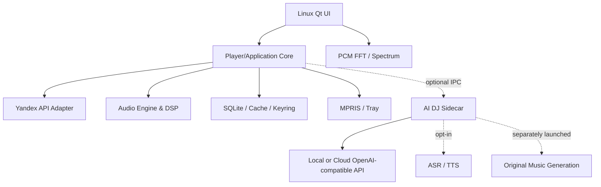

# Архитектура NeuroWave — предварительное решение

**Решение не окончательное:** сначала техническое сравнение основ, затем ADR о выборе.

## Изоляция ответственности
1. **GUI:** только действия, визуализация и пользовательские состояния, не сетевые блокировки.
2. **Service Adapter:** OAuth, каталог, «Моя волна», поиск, плейлисты, тексты; capability detection, retry/backoff, ошибки.
3. **Audio:** decode → optional DSP → output (PipeWire/PulseAudio); режим Pure обходит эффекты, Enhanced использует EQ, gain и limiter.
4. **Storage:** SQLite для метаданных, ограниченный cache, секреты в keyring.
5. **AI Sidecar:** отдельный необязательный процесс через валидированный RPC, разрешённый набор действий с плеером, подтверждение опасных или массовых операций.
6. **Music Studio:** отдельный GPU-процесс, не загружается при простом прослушивании.

## Кандидаты на основу
- [CloudMus](https://github.com/cloudmus/cloudmus): исследовать C++/Qt, mpv, лицензирование, актуальную сборку и аудио-хуки.
- [YaMusic](https://github.com/andfriden/YaMusic): исследовать Qt/QML, GPL-3.0 и реальную поддержку ключевых функций.
- Нативная собственная реализация: C++20, Qt6/QML, libmpv или GStreamer — лишь при объективной выгоде.

## Строгие принципы
- Аудиопоток никогда не ждёт LLM, UI или сеть.
- Каждая дополнительная служба включается только при необходимости.
- Внешний контент и LLM-ответы недоверенные; инструментальные команды через явные схемы и валидацию.
- Заранее измеряем RAM/PSS, CPU, загрузку GPU и latency для базового воспроизведения.
