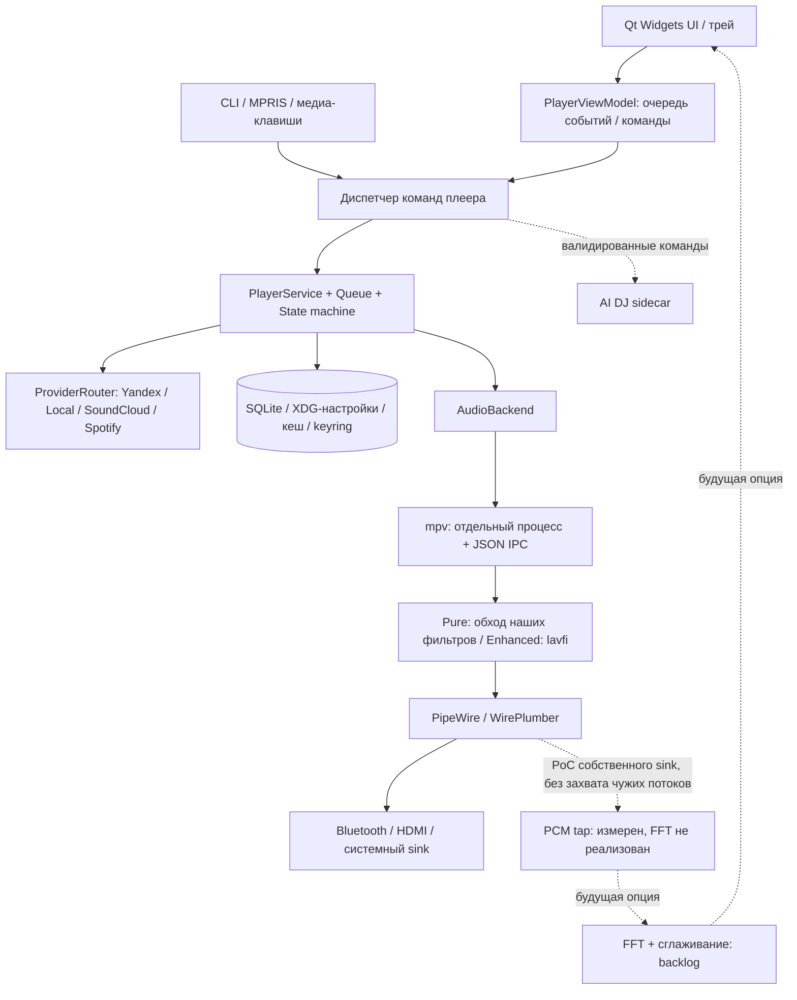

# Архитектура NeuroWave

Аудиодвижок выбран отдельным решением — [ADR-0005](decisions/0005-audio-engine.md):
внешний `mpv` + JSON IPC + граф `lavfi`. Остальные границы (провайдеры, UI,
хранение) описаны ниже. **Базовый Qt Widgets GUI уже реализован** (`ui/app.py`, `ui/viewmodel.py`, `ui/soundlab.py`); дальше требуется полевой UX-smoke и стабилизация.

## Изоляция ответственности

1. **UI:** действия, визуализация и состояния; никаких сетевых или блокирующих
   вызовов в UI-потоке; один экземпляр плеера на приложение.
2. **Диспетчер команд** (`dispatcher.py`): единственный последовательный
   исполнитель мутаций `PlayerService`, очереди, истории и режима звука.
   События MPRIS, трея, CLI, GUI и читателя mpv приходят сюда, а не вызывают
   плеер напрямую. Навигация поднимает поколение, поэтому устаревшее «next»
   не выполняется после нового.
3. **GUI** (`ui/`): `PlayerViewModel` собирает снимки состояния без Qt,
   позицию читает фоновый поток (IPC mpv не блокирует отрисовку), окно
   обновляется таймером. События ядра только складываются в очередь.
4. **Service Adapter:** OAuth, каталог, «Моя волна», поиск, плейлисты; проверка
   возможностей (`Capability`), retry/backoff, понятные ошибки.
5. **Audio:** `AudioBackend` → mpv (отдельный процесс) → `lavfi`-граф →
   PipeWire. Профили: встроенные в коде, пользовательские — данные в
   настройках; при чтении каждый профиль проверяется заново, битые
   отбрасываются по одному. Pure обходит наши фильтры, Enhanced применяет проверенный граф;
   фактическое состояние подтверждается чтением свойств mpv, а не фактом
   отправки команды.
6. **Выходы:** менеджер устройств читает `audio-device-list` mpv и свойства
   sink'ов, показывает тип (Bluetooth/HDMI/USB/аналог) и реальный кодек (SBC,
   a2dp-sink), а `auto` раскрывает в системный sink. Переключение проверяется
   по списку mpv до отправки: mpv молча принимает несуществующий id.
7. **Storage:** SQLite для метаданных и истории, ограниченный кеш, секреты в
   keyring с изоляцией по профилю.
8. **AI Sidecar (не реализовано):** запланированный отдельный необязательный процесс через валидированный RPC, разрешённый набор действий и подтверждение опасных операций.
9. **Music Studio (не реализовано):** планируемый отдельный GPU-процесс, который не должен загружаться при прослушивании.

## Контракты, которые нельзя нарушать

* Читатель IPC только читает и разбирает сообщения: синхронные команды из
  обработчика события запрещены (иначе дедлок, уже пойманный в QA).
* События `end-file` привязываются к конкретной загрузке: устаревший `eof`
  после ручного `next` не должен двигать очередь.
* Любая команда mpv проверяется по ответу (`error == "success"`), кроме
  явно необязательных; отказ `af` — это откат режима, а не «Enhanced включён».
* Цифровая громкость выше 100 % не считается безопасной, пока лимитер не
  подтверждён измерениями.
* PCM tap и FFT — подписчики со своим жизненным циклом: их сбой или задержка
  не имеют права останавливать звук.

## Сравнение с альтернативами (ограниченный полевой тест выполнен)

- [CloudMus](https://github.com/cloudmus/cloudmus) — C++/Qt, mpv.
- [YaMusic](https://github.com/andfriden/YaMusic) — Qt/QML, GPL-3.0.

Обе программы были запущены и измерены по старту, PSS, CPU и локальному FLAC; **авторизация и streaming с реальным аккаунтом в сторонних клиентах не проверялись**. См. [COMPARISON-CLOUDMUS-YAMUSIC.md](COMPARISON-CLOUDMUS-YAMUSIC.md). Решение о собственном Qt/UI и mpv основано на [ADR-0005](decisions/0005-audio-engine.md) и [фактических измерениях](SPRINT0-MEASUREMENTS.md), а не обещании превосходства по любому сценарию.

## Строгие принципы

- Аудиопоток никогда не ждёт LLM, UI или сеть.
- Каждая дополнительная служба включается только при необходимости.
- Внешний контент и ответы LLM недоверенные: инструментальные команды через
  явные схемы и валидацию, без конкатенации пользовательских строк в фильтры.
- RAM/PSS, CPU и задержка измеряются до и после каждой крупной правки звука.
