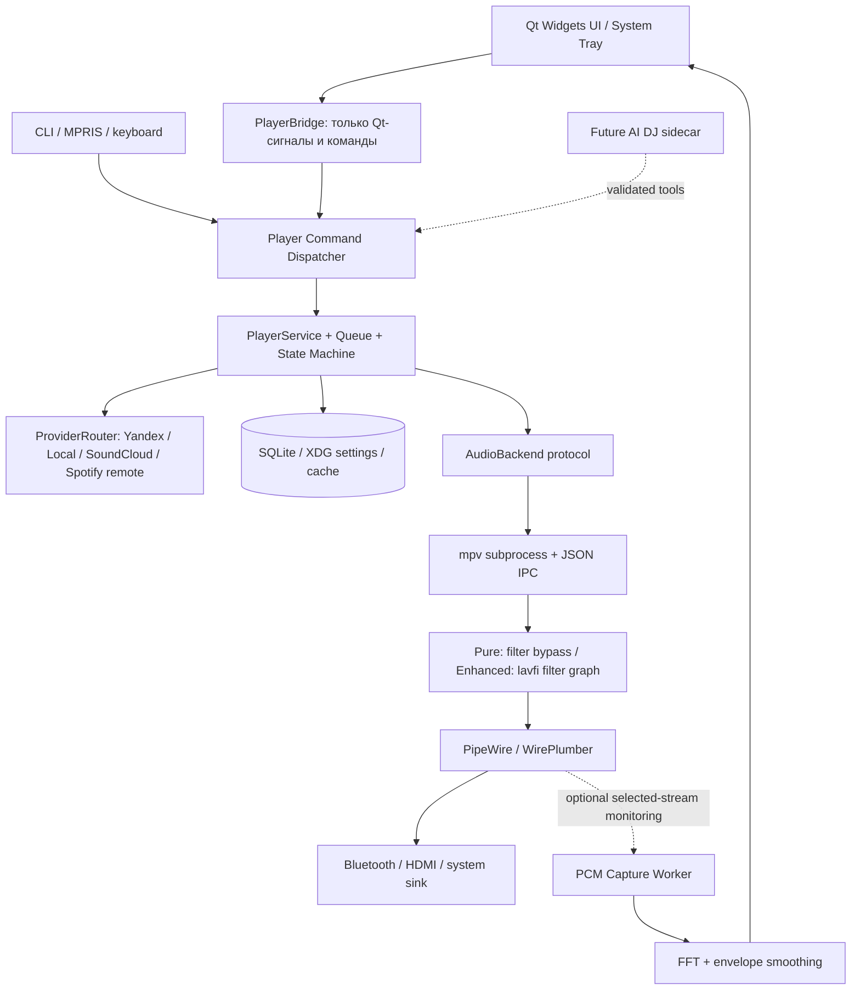
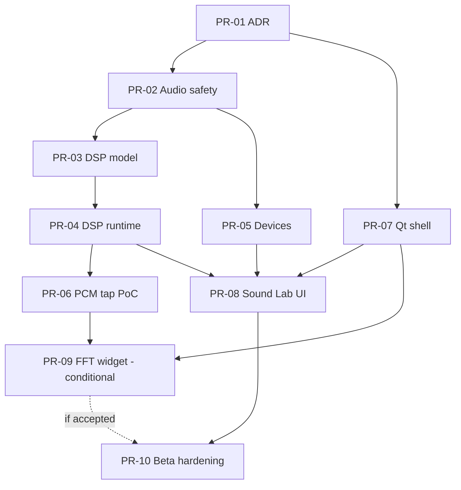

# NeuroWave — единый детальный план v1.0

**Направление:** ADR-0005 → Sound Lab → PCM/FFT → Qt Desktop → beta 0.2  
**Дата:** 16 ноября 2026 г.  
**Базовая ветка и SHA при подготовке:** `IIaJIaDuH/NeuroWave`, `main`, `87e339df484560cb2b93af58d207b4f6259b2acf` (влит PR #9).  
**Статус документа:** предложение к исполнению; не утверждение, что перечисленные функции уже написаны.  
**Входные документы:** [`docs/SPRINT0-MEASUREMENTS.md`](https://github.com/IIaJIaDuH/NeuroWave/blob/main/docs/SPRINT0-MEASUREMENTS.md), [`docs/QA-RUN-2026-11-16.md`](https://github.com/IIaJIaDuH/NeuroWave/blob/main/docs/QA-RUN-2026-11-16.md), ADR-0002/0003/0004, [`docs/ROADMAP.md`](https://github.com/IIaJIaDuH/NeuroWave/blob/main/docs/ROADMAP.md), [`PR #9`](https://github.com/IIaJIaDuH/NeuroWave/pull/9).

---

> **Эталон исполнения:** [три обязательных принципа NeuroWave](PROJECT-PRINCIPLES.md) (звук, лицензии, производительность). Любой PR и релиз должны проходить эти проверки.

## 0. Краткое решение и правила проекта

**Выбор:** оставить отдельный `mpv`-процесс, управление по JSON IPC, обработку звука через фильтры FFmpeg/libavfilter (`lavfi`) внутри `mpv`; Python-ядро сохранить, UI строить на PySide6 Qt Widgets согласно ADR-0003. `libmpv` — только резервный вариант после технического доказательства необходимости. Для спектроанализатора исследовать отдельную контролируемую PCM-ветку PipeWire; наличие `--ao=pcm` *не доказывает* одновременный живой tap без влияния на проигрывание.

**Жёсткие принципы:**

1. Музыка должна работать без UI, FFT, ИИ, GPU и сетевых дополнительных служб.
2. DSP не должен ломать воспроизведение: неверная конфигурация → безопасный Pure/последний рабочий профиль, видимая ошибка.
3. Без переписывания ядра, массового рефакторинга провайдеров, извлечения защищённого контента, изменения подписок или обхода DRM.
4. Каждый PR ограничен одним вертикальным функциональным срезом, имеет unit/integration/ручные проверки и откат.
5. Функция считается **готовой**, когда проходит реальные сценарии на Linux Mint + проверки в CI, а не когда заглушка возвращает успех.
6. Код, собираемый для публичной дистрибуции, проходит лицензионный аудит (в том числе `mutagen` и фактическая сборка `mpv`).
7. UI/ИИ не обращаются напрямую к сокету mpv, SQLite и токенам; только через узкие контракты ядра.

**Не входит в эту волну:** пятый потоковый провайдер, генерация музыки/ACE-Step, продвинутые мультиагентные системы, Spotify streaming внутри приложения, переписывание всего ядра на C++, полная QML-версия, автокоррекция звука по микрофону. Всё это отдельные будущие решения.

## 1. Что у нас фактически есть

| Измерение PR #9 | Значение | Как интерпретировать |
|---|---:|---|
| Headless NeuroWave, Bluetooth Bose QC Ultra, SBC | PSS **127,7 МБ**; CPU **1,87%** | 100-секундный прогон; без Qt UI и без будущего DSP |
| Headless NeuroWave, HDMI | PSS **121,8 МБ**; CPU **1,81%** | HDMI sink отмечался `SUSPENDED`, физическое звучание не подтверждено |
| Локальные файлы | PSS 89,8 МБ | замер короткий (~20 с), только ориентир |
| Chromium, локальная страница `<audio>` | PSS 458,0 МБ | не равнозначно сравнению с полноценным сайтом Яндекс Музыки |
| Начало сетевого проигрывания | Bluetooth 705 мс / HDMI 572 мс | величины конкретного стенда, не SLO для всех систем |
| Сетевые underrun | 0/20 BT и 0/19 HDMI | короткая сессия; не эквивалентно 6-часовому soak test |
| Аудиоформат | MP3 320 kbps → PipeWire → SBC/HDMI | высокая частота дискретизации/формат PCM не означает lossless или bit-perfect |
| Исправленные баги | IPC-reader, EOF deadlock, SQLite threads и др. | описаны в QA; по ним добавлены тесты |
| GitHub CI | pytest на Python 3.10/3.11/3.12 + интеграция с mpv | зелёный PR #9 по сообщению владельца; текущая конфигурация проверена в репозитории |

**Технические факты, важные для честности:**
- В `docs/ROADMAP.md` Sprint 0 всё ещё имеет `[ ]` на сравнение CloudMus/YaMusic и на ADR архитектуры. Принятие ADR закрывает **только второй** пункт. Сравнение альтернатив следует либо реально выполнить из исходников, либо пометить как осознанно отложенное с причиной в ADR. Отсутствие пакета в `apt/flatpak/snap` не является сравнением проектов.
- Устройство Bose QC Ultra в замере использовало **SBC**. Любые разговоры о «Hi-Fi» сначала требуют проверить реальный активный Bluetooth-кодек и ограничения устройства.
- `libmpv.so.2` обнаружена, но её наличие не устанавливает ни качество PCM tap, ни точные обязательства лицензии. Стандартный GPL-`mpv` и `-Dgpl=false` LGPL-сборки имеют разные условия, плюс учитываются линкованные библиотеки.
- `mutagen` импортируется в локальном провайдере и имеет GPL-2.0-or-later, хоть и объявлен optional extra. Перед выбором permissive-лицензии проверить замену на MIT `tinytag` либо GPL-совместимую схему распространения.

## 2. Целевая архитектура



### 2.1. Контракты и владение потоками

- **Player Command Dispatcher:** один последовательный исполнитель мутаций `PlayerService`, очереди, сохранения истории и переключения режимов; события MPRIS, трея, CLI, GUI, mpv-reader маршрутизируются сюда. Запрещены конкурирующие вызовы `play/next/stop` из разных потоков. Таймауты, отмена устаревших команд и `generation_id` для трека обязательны.
- **mpv IPC reader:** *только* чтение/разбор сообщений и разрешение ожидающих request-id; никакой синхронной команды из обработчика события. Текущий отдельный event-thread сохраняется, но направляет изменение состояния через диспетчер.
- **AudioEngine/MpvBackend:** чтение фактических mpv-свойств (`time-pos`, `pause`, `core-idle`, `audio-device`, `audio-params`, `af`, ошибки), пометки текущего трека и режима. Успешное IPC `loadfile` ≠ гарантия звучания; подтверждать по событиям/свойствам.
- **DSP Controller:** чистое преобразование валидированного пресета в поддерживаемый фильтр-граф + транзакционное применение + rollback на безопасную конфигурацию.
- **PCM/FFT:** подписчик с отдельным lifecycle. Его сбои и задержки не имеют права блокировать декодер или диспетчер плеера.
- **PlayerBridge:** Qt-объект с сигналами; никаких сетевых запросов в UI-thread. GUI не создаёт свой второй экземпляр плеера при каждом открытии окна.

### 2.2. Предлагаемые новые модули (пути — рекомендации, не существующие файлы)

```text
src/neurowave/
  audio/
    backend.py             # сохранить базовый Protocol
    mpv.py                 # IPC + фактические свойства + lifecycle
    engine.py              # control API (новый тонкий слой)
    dsp_profiles.py        # dataclasses, валидация, миграции пресетов
    dsp_graph.py           # построение lavfi-графа, без сетевых зависимостей
    dsp_controller.py      # apply/rollback, bypass, event notifications
    devices.py             # enumerate/map PipeWire sink ↔ mpv output
    meter.py               # FFT кадры, ring buffer, smoothing
    capture_pipewire.py    # опциональный PCM tap (только после PoC)
  runtime/
    dispatcher.py          # сериализованный command/event loop
  ui/
    app.py                 # QApplication, composition root
    bridge.py              # QObject, signals, nonblocking calls
    main_window.py
    widgets/
      now_playing.py
      queue_view.py
      search_view.py
      sound_lab.py
      spectrum.py
    resources/...
packaging/
  experiments/             # PoC, не продакшен-зависимости
    fft-capture/README.md
    dsp-render/README.md
tests/
  test_dsp_profiles.py
  test_dsp_graph.py
  test_dsp_controller.py
  test_audio_devices.py
  test_pcm_capture.py
  test_fft_meter.py
  test_ui_bridge.py
  test_gui_smoke.py
  test_audio_soak.py
```

В `pyproject.toml` оставить `ui`, `desktop`, `local` как extras, новые зависимые библиотеки добавлять с минимальным охватом. CLI обязан работать при удалённой PySide6 и выключенном FFT.

## 3. ADR-0005 — решение и основания

**Выбрать:** separate-process mpv + JSON IPC + `lavfi`; систему PipeWire считать аудиомаршрутом/возможным источником tap, но не обязательным DSP для работы в других Linux-конфигурациях.

**Отвергаем сейчас:**
- прямую интеграцию `libmpv` (не доказана функциональная необходимость, возможны новые проблемы с жизненным циклом и лицензированием);
- собственный DSP-декодер на Python (дублирование libavfilter, неоправданная latency и CPU);
- только системный `filter-chain` как единственный DSP (глобальный слой делает профиль менее предсказуемым, особенно при переносе между компьютерами).

**Пересмотр ADR обязателен, если** после двух PoC/циклов оптимизации доказано одно из условий:
1. Не удаётся получить PCM **именно NeuroWave** в реальном времени без захвата звука других приложений и без разрыва воспроизведения;
2. DSP не поддерживает нужное управление без заметных щелчков/разрывов, а альтернативная lavfi-конфигурация не помогает;
3. Persistent-underrun/crash/CPU/PSS не проходят SLO на целевой машине, и сравнительный прототип `libmpv` показывает измеримый выигрыш;
4. Требуется тип обработки, который нельзя реализовать в libavfilter или PipeWire без неприемлемых компромиссов.

**Лицензирование:** вызов отдельной программы по IPC *обычно* не делает собственный код GPL автоматически, но распространение mpv вместе с продуктом требует выполнения обязательств к mpv и его сборке; точное соответствие определяется реальной поставкой и совокупностью компонентов. `-Dgpl=false` не волшебный переключатель лицензии: mpv прямо требует проверять фактические GPL-only файлы и связанные библиотеки. `mutagen` — отдельное препятствие для permissive-distribution. Юридический аудит нужен перед релизом, без ложной формулы «любой libmpv = GPL».

## 4. Sound Lab — ТЗ по звуковому тракту

### 4.1. Пользовательские режимы

| Режим | Что делает | Чего не обещает |
|---|---|---|
| **Pure Hi-Fi** | обходит *наши* EQ, нормализацию, компрессию, лимитер; ограниченный безопасный цифровой gain | не является гарантией bit-perfect: mpv/PipeWire могут изменять формат/ресемплировать, Bluetooth SBC — lossy |
| **Enhanced** | PEQ, bass shelf/clarity, preamp, защита от перегрузки, опциональная loudness-коррекция | не восстанавливает отсутствующие детали MP3/SBC; не делает звук «lossless» |
| **A/B** | быстрый уровень-согласованный переход Pure↔Enhanced | не сравнивать просто более громкую обработку с тихим Pure |

Первый запуск должен работать в Pure, с возможностью мгновенно перейти в Enhanced. Пресеты индивидуальны и назначаются на `device_id` или «общий по умолчанию». При неподдерживаемом фильтре возвращаться к Pure и сообщать причину.

### 4.2. Параметрический эквалайзер

**В первой версии:** 8 полос PEQ, затем при необходимости 10. Для каждой полосы хранить: `enabled`, `type` (peaking/lowshelf/highshelf), `frequency_hz`, `gain_db`, `q`. Ограничения: частота в допустимом диапазоне относительно фактической частоты дискретизации/Nyquist; по умолчанию -12…+12 dB, Q от 0.3 до 10.0, preamp -18…0 dB (положительные значения — только в режиме с проверенным headroom и limiter).

**Пресеты v1:**
- `Flat` — все полосы 0 dB, Pure остаётся эталоном;
- `Warm` — умеренное низкочастотное повышение и небольшая коррекция верхней середины; *не навязывать наушникам без измерений*;
- `Clarity` — мягкая коррекция разборчивости; без агрессивных 6–10 dB бустов;
- `Custom` — пользовательский профиль, синхронизация не нужна, хранится только локально.

**Безопасный стартовый пример, не калибровка Bose:** Low-shelf около 100 Гц +3 dB, preamp -5 dB, остальные полосы 0 dB, limiter включён. Фактическую громкость и пики проверить тестовыми сигналами; соседние полосы суммируются и могут превышать максимум отдельной полосы.

### 4.3. Реализация DSP графа

Один граф на базе `lavfi`: `preamp/volume -> low-shelf / peaking EQ -> (optional measured loudness) -> limiter`. Порядок и конкретные опции подтверждаются тестом на установленном libavfilter. `loudnorm` не включать «по умолчанию»: динамическая однопроходная нормализация может изменять уровень и потребление ресурсов. И `alimiter` при обычной частоте дискретизации — не автоматическая сертификация **true peak**.

Пример **псевдоконтракта**, а не готовой команды FFmpeg (параметры определит и протестирует `DSPGraphBuilder`):

```python
AudioProfile(
    id="warm",
    mode="enhanced",
    preamp_db=-5.0,
    bands=[
        EqBand(kind="lowshelf", frequency_hz=100, gain_db=3.0, q=0.7),
    ],
    limiter=Limiter(enabled=True, ceiling_dbfs=-1.0,
                    lookahead_ms=5, release_ms=80),
)
```

Для реализации используются mpv `af set` / `af toggle` и, где доступно, `af-command` с именованным фильтром. **Не** допускать отправки произвольных пользовательских строк как фильтр-графа; создавать граф из типизированных числовых параметров. Точный синтаксис/экранирование в JSON IPC фиксировать integration-тестом, не строить строку ручной конкатенацией поверх сырого пользовательского текста.

**Переключение пресетов без щелчка:** сначала PoC `af-command` отдельных параметров; если перенастройка вызывает разрыв, реализовать короткий безопасный спад/восстановление gain с измеренной длительностью или отложенное применение на следующем треке. Нельзя обещать «без щелчка» до теста на BT/HDMI.

### 4.4. Громкость >100% и anti-clipping

Сейчас `Settings.MAX_VOLUME=130`, а `MpvBackend.set_volume` тоже допускает 130, хотя полноценного DSP-лимитера нет. Это надо исправить **до** открытого релиза:

- [ ] Пока Enhanced с защитой не принят — ограничить пользовательскую цифровую громкость на 100%; если нужно сохранить совместимость конфигурации 130, читать значение, но фактически нормализовать/предупреждать.
- [ ] В Enhanced при >100% поставить лимитер **после всех усилений** и обязательный предварительный запас; не путать процент шкалы с усилением в dB и пределом драйвера.
- [ ] Оценивать ceiling в dBFS, отдельно измерять inter-sample/true peak при oversampling; в релизных обещаниях не указывать «-1 dBTP» без доказанной реализации.
- [ ] Не допускать многократного двойного повышения gain (`mpv volume` + DSP preamp + системная громкость) без информирования пользователя.
- [ ] Любое переключение пресета должно сохранять слышимый уровень в допустимых границах, без опасных скачков наушников.
- [ ] При падении DSP-бэкенда возвращать безопасное ограничение громкости, а не продолжать raw 130%.

### 4.5. Контракты управления

Предлагаемые методы независимого от Qt `SoundController`:

```python
list_devices() -> list[AudioDevice]
select_device(device_id: str | None) -> AudioDeviceResult
get_output_state() -> OutputState  # actual output, codec if available, sample rate
get_profile() -> AudioProfile
list_profiles() -> list[AudioProfile]
set_mode(mode: Literal["pure", "enhanced"]) -> ApplyResult
apply_profile(profile: AudioProfile) -> ApplyResult
set_band(index: int, gain_db: float, ...) -> ApplyResult
reset_to_safe() -> ApplyResult
get_dsp_health() -> DspHealth
```

Не подменять `Settings.audio_backend` именем устройства. Устройство и аудиорежим — разные настройки. Кешировать профиль по **стабильному идентификатору** sink, с fallback при переименовании WirePlumber и при исчезновении Bluetooth.

### 4.6. Тесты качества

В `tests/fixtures/audio` генерировать маленькие собственные синусоиды 60/100/1000/8000 Гц, sweep, тихий сигнал, 0 dBFS, короткий импульс и стереофайл с раздельными каналами. Файлы создавать тестом или хранить только небольшие оригинальные fixtures.

**Проверки:**
- Pure без наших пользовательских фильтров; уровень и частотная характеристика по выбранному цифровому tap не изменены нашим DSP.
- Gain +6 dB повышает контролируемый сигнал ожидаемо в допустимой погрешности; peaking и shelf меняют нужные частоты, соседние полосы не дают неконтролируемого усиления.
- Limiter не позволяет цифровым пикам превысить заявленный sample-peak ceiling; inter-sample peaks оценить отдельно.
- На переключении A/B нет разрывов/щелчков выше принятого порога и нет скачка SPL из-за различия громкости (при отсутствии калибровки SPL — согласовать цифровые уровни).
- Пресет из ошибочного JSON, NaN/Inf, отрицательный Q, недопустимая частота отклоняются.
- Ошибка `af` от mpv приводит к rollback, а не к ложному статусу «Enhanced включён».
- 60 минут MP3/FLAC/смешанная очередь, pause/seek/switch profile/reconnect не рушат mpv.

## 5. Audio Device Manager — BT/HDMI

### Функции P0

- Список: `System default`, `Bluetooth (имя)`, `HDMI (имя)`, физическое состояние/доступность; не показывать «проверено» для отключённых sink.
- Указывать **действующий** output `audio-device`, PipeWire sink и профиль BT (`a2dp-sink` vs HFP), кодек SBC/AAC/LDAC если PipeWire надёжно сообщает его, sample rate, число каналов, текущий режим DSP.
- `select_device()` должен менять реальный маршрут конкретного приложения, а не глобальный default без ведома пользователя (предпочтение: mpv `audio-device`/PipeWire stream route; fallback — системный выбор только с явным предупреждением).
- При пропадании BT: пауза/переход на дефолт по настройке пользователя, без 130% и без зависшего UI.
- На смену sink — выбранный для него пресет или мягкий fallback Flat; не включать bass boost автоматически на новый выход.

### Полевые испытания

- Bose QC Ultra: SBC baseline + проверка иных реально поддерживаемых кодеков без обещаний о наличии LDAC/AAC; шум, громкость, треск на переключении, переподключение.
- HDMI: подключить **реальный экран/ресивер и подтвердить звучание**, а не ограничиваться ненулевым `audio-device`; проверить то же с отсоединением кабеля.
- При одновременном YouTube/игре/системном звуке приложение не перехватывает общий sink и не сбрасывает чужую громкость.
- 20 циклов BT disconnect/connect и 20 циклов Pure/Enhanced, каждый с логом исхода.

## 6. PCM tap и FFT — отдельный PoC с чёткой границей риска

### 6.1. Чего **пока нет**

`mpv --ao=pcm --ao-pcm-file=…` умеет выгрузить декодированный PCM в WAV, но сам по себе не даёт надёжный *параллельный* live feed и может переключить output в файл вместо слухового устройства. Нельзя строить на этой проверке обещание готового спектра. Технический выбор нужно сделать экспериментом.

### 6.2. Первичный маршрут — PipeWire per-app capture

PoC на Linux Mint PipeWire 1.0.5:

1. Найти конкретный поток `mpv` по свойствам node/port после запуска NeuroWave (`pw-dump`, `pw-link`, диагностические инструменты). Параллельно запустить другое приложение со звуком.
2. Проверить возможный **отдельный monitor/виртуальный sink** или tee/loopback для *этого* потока. Не считать монитор общего physical sink подходящим — он захватывает все приложения.
3. Развести поток только NeuroWave на обычный playback и tap на PCM capture, без дублирования звука и без изменения default output остальных программ.
4. При необходимости создать отдельный приватный PipeWire stream/виртуальный sink для NeuroWave и WirePlumber routing rule, не устанавливать глобальный модуль навсегда.
5. Зафиксировать, какой сигнал приходит в tap: до DSP/после DSP, до конечной громкости/после. Для визуализации предпочтителен post-DSP сигнал проигрывателя; подпись в UI должна этому соответствовать.
6. Проверить stop, seek, переключение sink, BT reconnect и удаление tap, не нарушая музыку.
7. Измерить стоимость по PSS, CPU и задержке. Избежать записи аудио на диск в продакшене: ring buffer исключительно в памяти.

**Альтернативы:** нативный минимальный capture worker на libpipewire; PipeWire filter-chain/loopback с изолированным node; в последнюю очередь — специализированный audio tee на стороне mpv. Не переходить на `libmpv`, пока не доказано, что он действительно решает задачу tap: обычный client API не гарантирует готового callback с PCM.

### 6.3. FFT

- Capture формат: float32 PCM, моно для спектра через корректное сведение стерео, адаптер для другой частоты дискретизации.
- Ring buffer 1–2 секунды, bounded; декодер не ожидает от визуализатора.
- FFT 2048 или 4096 отсчётов, Hann window, преобразование амплитуд в dBFS; сравнение с эталонными синусоидами.
- Сглаживание attack/release, логарифмические частотные bins (например 32 или 64), ограничение отрисовки **до 30 FPS**.
- PSS overhead tap+FFT ориентир ≤ 25 МБ и CPU ≤ 3% одного ядра сверх baseline **как цель**, измерить в PoC; если не укладывается — снижать rate/бинов/частоту обновления.
- При минимизации окна, выключенном спектре или режиме headless: остановить capture, освободить буферы и процесс.
- Нет входа с микрофона, нет записи речи/прочих приложений. В настройках ясно обозначить, какой источник анализируется.

### 6.4. Gate PCM/FFT

- [ ] Реальный график отражает переключение тестовых тонов 100 Гц → 1 кГц → 8 кГц.
- [ ] Другое приложение играет одновременно; его звук **не попадает** в спектр NeuroWave.
- [ ] 30 минут с FFT без dropouts и значимого дополнительного CPU.
- [ ] При остановке FFT/закрытии окна не остаются виртуальные потоки, процессы и записи.
- [ ] При отключении BT/HDMI графика пересоединяется корректно или автоматически отключается, а музыка продолжает работать.

**Если gate не пройден:** выпускать GUI без FFT (или с явно отключённой опцией), не маскировать запись общего sink под персональный спектроанализатор.

## 7. Qt Desktop — от headless к приложению

### 7.1. Техническая основа

Решение из ADR-0003: `PySide6-Essentials` + **Qt Widgets**, ядро в одном Python-процессе, `mpv` в дочернем. `QAbstractListModel`/модели представления для длинных списков, lazy загрузка обложек, фоновые запросы, однопоточное изменение состояния через dispatcher. Весь P0 интерфейс можно реализовать без OpenGL/QML.

Точка запуска:

```bash
neurowave-gui          # новый entrypoint, по возможности
neurowave wave         # текущий headless-путь без изменений
neurowave tray         # обратная совместимость
```

### 7.2. Экраны P0 и взаимодействия

1. **Сейчас играет** — обложка, артист, название, качество реального источника, прогресс/seek, play/pause, next/previous, repeat/shuffle, громкость, sink и активный профиль звука.
2. **Моя волна** — запуск, пауза, feedback, автоматическое продолжение при исчерпании порции; отдельная задача, если текущая волна останавливается на конце батча.
3. **Поиск** — задержка ввода 250–350 мс, запрос в worker, отмена устаревших результатов; фильтрация по возможностям конкретного провайдера.
4. **Библиотека/плейлисты** — на этапе P0 только реально подтверждённые методы API; не показывать обещанные, но неподдерживаемые функции.
5. **Очередь** — порядок, drag-and-drop позднее, вставить следующим, удалить, repeat/shuffle, смешанные идентификаторы `provider:id`.
6. **Sound Lab** — тумблер Pure/Enhanced, активный sink, выбор пресета, простой PEQ, reset, индикатор limiter, предупреждение при 100%+.
7. **Настройки** — вход и logout, XDG paths, cache quota, приватность, audio output, системный трей, снижение анимаций, лог диагностики без токенов.

UI-состояния: initial loading, нет подключения, токен истёк, требуется подписка, нет sink, недоступная функция, пустая библиотека, ошибка DSP, отсутствует PCM tap, отсутствует mpv/Qt; каждое состояние с конкретным дальнейшим действием.

### 7.3. Визуальная система P0/P1

- Фон: глубокий почти чёрный сине-графитовый; акцент cyan/blue/purple, но без текстового «нейрослопа» и неоновых ореолов под каждой кнопкой.
- Базовая сетка 8 px, размеры текстов 12–16 px, контраст для подписи/активных кнопок, доступные focus ring и подсказки.
- Минимальная ширина 960, адаптация до 760; доступ с клавиатуры, медиаклавиши, контекстное меню в трее, возможность уменьшить движение.
- **P1**: анимированный спектр, аккуратные переходы, визуальный редактор EQ. Не мешать клику по управлению частыми repaint.
- Одна тема на QSS; QML-остров или QPainter-визуализатор выбирать после замеров, не до.

### 7.4. Потоки, UI и стабильность

- Все Qt-виджеты только в главном UI-thread; внешние события → Qt Signals/queued connection.
- Сеть, потоковый поиск, импорт больших локальных папок и загрузка изображений — worker-pool.
- Никогда не открывать второй sqlite connection в каждом виджете без необходимости; один владелец состояния.
- Исключить race: поток `mpv` завершил трек, UI одновременно нажал Next, MPRIS послал Pause — должен быть один согласованный результат, без двойного skip.
- Стоп/закрытие GUI корректно завершает spectrum capture, mpv, сервисы, таймеры, подписки; отдельный headless процесс не должен оставаться сиротой.

## 8. Метрология и целевые бюджеты

Это **проектные пороги**, а не уже достигнутые показатели. PSS измеряем для дерева процессов, в том числе `mpv`, GUI, FFT worker; совместно используемую память сравниваем одинаковым способом на одной машине.

| Сценарий | Цель | Жёсткость |
|---|---|---|
| Headless Pure, BT MP3 320 | PSS не выше baseline 127,7 МБ +15% (≈147 МБ) | gate на необоснованную регрессию |
| Headless Enhanced | +≤20 МБ к Pure в типовом пресете | ориентир, уточняется PoC |
| GUI Pure, открыто окно | **≤200 МБ** PSS суммарно | исходный ориентир ТЗ; при превышении — профилирование и ADR, не скрытие данных |
| GUI+FFT+Enhanced | желательно ≤230 МБ | исследовательская цель, не критерий отказа от архитектуры |
| Фоновый проигрыватель (окно закрыто/минимизировано) | FFT остановлен; PSS снижается | обязательное поведение |
| Звук на 60 мин | 0 ошибочных завершений, 0 пользовательских заметных underrun | gate |
| Работа на 6 часов (soak) | нет накопления сирот, устойчивого роста PSS и ошибок перехода | release gate |
| GUI реакция Play/Pause | управление не блокирует Qt-event-loop | gate; измерять p95 |
| UI спектр | до 30 FPS, без сбоев звука | gate FFT |
| Первое звучание | фиксировать median/p95 из ≥10 повторов по каждому sink | метрика, пока без универсального численного обещания |

**Инструменты:** `smoke-measure.sh`, `/proc/<pid>/smaps_rollup`, `pw-top`, `pactl`, `pw-dump`, `ffmpeg ebur128/astats`, JSON IPC mpv, `pytest`, `gdbus`/`playerctl`, тестовые PCM fixtures, протокол ручного A/B.

**Повторить четыре сценария:** Pure BT, Enhanced BT, Pure HDMI с реально включённым дисплеем, Enhanced HDMI; плюс фоновый UI, UI+FFT, воспроизведение при параллельной игре/браузере. Протоколы и CSV сохранять в `docs/benchmarks/`, без персональных путей и токенов.

## 9. План PR по порядку (готовый backlog)

### PR-01 — ADR-0005 + реестр рисков + обновление roadmap

**Ветка:** `docs/adr-0005-audio-engine`  
**Файлы:** `docs/decisions/0005-audio-engine.md`, `docs/ROADMAP.md`, `docs/ARCHITECTURE.md`, `docs/RISKS.md`.

- [ ] Зафиксировать выбранный mpv+IPC+lavfi как основную архитектуру.
- [ ] Честно отметить, что CloudMus и YaMusic не были запущены/сравнены на стенде.
- [ ] Зафиксировать `libmpv` и PipeWire filter-chain как альтернативы с re-open triggers.
- [ ] Отразить риск лицензирования mutagen/Qt/FFmpeg/mpv и отсутствие лицензии в публичном репо.
- [ ] Не помечать весь Sprint 0 полностью закрытым до решения по сравнению альтернатив.

**DoD:** ADR согласован, есть решение о судьбе незавершённого сравнения, GitHub CI зелёный, никаких изменений runtime-кода.

### PR-02 — Audio safety и качество ошибок IPC

**Ветка:** `fix/audio-volume-safety`  
**Файлы:** `config.py`, `audio/mpv.py`, `tests/test_mpv_backend.py`, новые тесты.

- [ ] Пока нет валидированного лимитера — безопасно ограничить 100% или выключить boost и вывести сообщение.
- [ ] Проверить ответ `mpv` `error != success` для любых команд, кроме специально необязательных; явно поднимать `PlayerError`.
- [ ] Гарантировать фиксацию фактических mpv-свойств/ошибок для `loadfile`, seek, volume, af.
- [ ] Привязать события `end-file` к generation-id текущего трека, исключить старые EOF после ручного Next.
- [ ] Добавить тесты на отказ `af`/mpv, сохранение сессии, shutdown, ошибку backend, некорректный gain.

**DoD:** ни один неисправный DSP/высокий gain не может перейти в ложное безопасное состояние; действующие тесты mpv и CLI проходят.

### PR-03 — DSP profile model + graph builder (pure function)

**Ветка:** `feat/soundlab-model`  
**Файлы:** `audio/dsp_profiles.py`, `audio/dsp_graph.py`, `config.py`, unit-тесты.

- [ ] Ввести версионируемую схему `AudioProfile` с миграциями.
- [ ] Реализовать строгие диапазоны и валидацию NaN, infinity, Q, frequency, gain.
- [ ] Реализовать сериализацию preset → детерминированный lavfi graph.
- [ ] Pure возвращает *пустой NeuroWave DSP graph*.
- [ ] Первая библиотека пресетов Flat/Warm/Clarity, локальный Custom.
- [ ] Сверить generated graph с поддержкой установленного mpv/libavfilter и отловом отсутствующих фильтров.

**DoD:** Python unit tests, воспроизводимость графа, отсутствие пользовательской string injection.

### PR-04 — DSP runtime / A-B / fallback

**Ветка:** `feat/soundlab-engine`  
**Файлы:** `audio/dsp_controller.py`, `audio/mpv.py`, `player.py` adapter, интеграционные тесты.

- [ ] Реализовать применение фильтров через IPC без перезапуска всей сессии.
- [ ] При успехе синхронизировать `desired_mode` и `actual_mode`, `get_property af`.
- [ ] При отказе — rollback на последний подтверждённый профиль или Pure.
- [ ] Снизить риск щелчков, тестировать на wave и локальных файлах, повторных переключениях.
- [ ] Хранить последние настройки по профилю устройства; при смене устройства без подходящего профиля — безопасный Flat.
- [ ] A/B с согласованием громкости, без фальшивого «Enhanced лучше, потому что громче».

**DoD:** 100 последовательных A/B переключений в integration-стенде, 20 на реальных устройствах, лог ошибок и фиксация отката.

### PR-05 — Audio device manager

**Ветка:** `feat/audio-device-routing`  
**Файлы:** `audio/devices.py`, CLI diagnostics, tests.

- [ ] Собрать таблицу `PipeWire sink → mpv audio-device name` (не все mpv драйверы поддерживают explicit routing).
- [ ] Реализовать `list/select/status`, `default` и устойчивые ID.
- [ ] Device disconnect/reconnect → определённая policy, не молчаливое переключение.
- [ ] Не менять глобальный sink без явного согласия.
- [ ] Добавить диагностику SBC/A2DP/HFP и sample rate.
- [ ] Проверить физическое звучание HDMI на подключённом устройстве.

**DoD:** реальные BT/HDMI, корректное сохранение/восстановление, тесты на исчезнувшее устройство.

### PR-06 — PCM tap proof-of-concept (без GUI)

**Ветка:** `experiment/pipewire-pcm-tap`  
**Файлы:** `packaging/experiments/fft-capture`, PoC test generator, benchmark protocol.

- [ ] Установить точную точку снятия post-DSP PCM только потока NeuroWave.
- [ ] Проверить параллельный звук другого приложения: нулевая утечка в FFT.
- [ ] Измерить PSS/CPU и delay, остановку/перезапуск tap.
- [ ] Документировать выбранный способ либо честный отказ с причинами.

**DoD:** доказанный tap, без управления системным default audio, без изменения пользовательских persistent WirePlumber rules.

### PR-07 — Qt GUI foundation

**Ветка:** `feat/qt-desktop-shell`  
**Файлы:** `ui/app.py`, `ui/bridge.py`, `ui/main_window.py`, `pyproject.toml`, desktop entry, тесты.

- [ ] Один `QApplication`, один composition-root PlayerService, одно управляемое shutdown.
- [ ] Qt Widgets тёмная тема, экран «Сейчас играет», поиск, очередь, транспорт, уведомления/ошибки.
- [ ] Сигналы от dispatcher/worker, без network в GUI thread.
- [ ] Медиа-клавиши и трей совместно управляют одним плеером.
- [ ] CLI без PySide6 продолжает работать.
- [ ] GUI PSS измерен при открытом окне; оптимизация не через преждевременную перепись на C++.

**DoD:** реальная музыка из аккаунта, Next/Pause/Search, exit без сирот; manual UI smoke на Mint.

### PR-08 — Sound Lab UI

**Ветка:** `feat/qt-soundlab`  
**Файлы:** `ui/widgets/sound_lab.py` и сервисы UI bridge.

- [ ] Pure/Enhanced, пресеты, регуляторы PEQ, сброс, безопасный boost.
- [ ] Текущий реальный output и статус DSP/лимитера.
- [ ] Корректный keyboard navigation, save, restore, exception feedback.
- [ ] Bypass не имеет скрытого EQ.

**DoD:** пользователь без терминала изменяет режим и слышит разницу; регрессионные аудиотесты зелёные.

### PR-09 — FFT Engine + Spectrum Widget (только если PR-06 успешен)

**Ветка:** `feat/fft-spectrum`  
**Файлы:** `capture_pipewire.py`, `meter.py`, `ui/widgets/spectrum.py`.

- [ ] Ограниченный ring buffer, Hann FFT и маппинг в логарифмические полосы.
- [ ] Рисование Qt Widgets/QPainter (QML только если доказанная причина).
- [ ] Disable при minimize, закрытии и простое; надёжный cleanup.
- [ ] Виджеты только Qt-main-thread; capture не блокирует player.
- [ ] Информировать о недоступном tap, не подменять случайным микрофоном.

**DoD:** проходит gate §6.4, PSS/CPU в опубликованном benchmark.

### PR-10 — Beta hardening, Packaging, License

**Ветка:** `release/beta-0.2`  
**Файлы:** `LICENSE`, `.github/workflows/*`, `packaging/`, `docs/`, `pyproject.toml`.

- [ ] Принять и документировать лицензию приложения, зависимости, embedded / separately installed mpv.
- [ ] Проверить замену GPL `mutagen` на MIT `tinytag` для read-only-тегов либо выбрать GPL-совместимую публикацию; **не копировать исходники из другого проекта без проверки прав**.
- [ ] Проверить Qt LGPL notices и что реально попадает в AppImage.
- [ ] Автоматизировать unit/integration + lint/type/security/secret checks; тест чистой установки.
- [ ] AppImage/альтернативный дистрибутивный пакет как результат по проверенной сборке, не обещание заранее.
- [ ] Протестировать PipeWire и PulseAudio fallback, если это целевая поддержка.
- [ ] Честный changelog, known issues, release notes, не указывать фейковую поддержку FLAC/LDAC.
- [ ] 6h soak, exit/signal, bluetooth reconnect, GUI latency, измерения PSS.

**DoD:** открытая beta пригодна к самостоятельной установке и воспроизведению без IDE/venv, нет секретов, лицензии прозрачны, успешный QA-отчёт.

## 10. Матрица тестов (минимально необходимая)

| Сценарий | Unit | mpv CI | Mint manual | Критерий |
|---|:---:|:---:|:---:|---|
| Pure bypass | ✓ | ✓ | ✓ | Нет наших эффектов |
| Невалидный EQ JSON / NaN | ✓ | — | — | Отклонить до IPC |
| Фильтр mpv не существует | ✓ | ✓ | ✓ | Error + safe rollback |
| Preset применить/снять | ✓ | ✓ | ✓ | Состояние и свойства mpv совпадают |
| DSP → End-of-track → новый трек | ✓ | ✓ | ✓ | Пресет не теряется, EOF не блокируется |
| Pause/seek во время изменения EQ | ✓ | ✓ | ✓ | Нет гонок/ложных состояний |
| 100% → 130% без лимитера | ✓ | ✓ | ✓ | Безопасно запретить до реализации limiter |
| 100% → 130% с limiter | ✓ | ✓ | ✓ | Только при доказанном ceiling, без клиппинга |
| Bluetooth исчезает | ✓ | — | ✓ | Предсказуемый fallback |
| HDMI физический звук | — | — | ✓ | Слышно на дисплее/ресивере |
| Спектр 100 Hz/1 kHz/8 kHz | ✓ | optional | ✓ | Верные частотные области |
| Чужой звук одновременно | — | — | ✓ | Нет чужой энергии в tap |
| GUI + MPRIS + трей одновременно | ✓ | optional | ✓ | Один PlayerService, нет дублей команд |
| Закрытие GUI во время стрима | ✓ | ✓ | ✓ | Нет mpv/capture-сирот |
| Нет keyring/нет PipeWire/нет Qt | ✓ | ✓ | ✓ | Graceful fallback |
| 6 часов и большие плейлисты | — | optional | ✓ | 0 зависаний, нет устойчивой утечки |

**Тесты не должны требовать реального аккаунта в GitHub CI**: network API фейкуются, интеграция mpv использует собственные аудиотесты, live smoke выполняется вручную на целевой машине без коммита токенов.

## 11. Сводный checklist релиза beta 0.2

### Решение и права
- [ ] ADR-0005 принят, причины альтернатив документированы.
- [ ] В Sprint 0 сравнение CloudMus/YaMusic либо выполнено, либо явно перенесено с обоснованием.
- [ ] Выбрана реальная лицензия для своего кода и пути использования GPL/LGPL библиотек.

### Аудиодвижок
- [ ] mpv IPC надёжен при простое и смене треков, обработка ошибок явная.
- [ ] Headless работает без GUI.
- [ ] 100% safe до limiter; DSP включается только после проверки.
- [ ] Pure и Enhanced действительно дают разные документированные тракты.
- [ ] Пресеты применяются/сбрасываются без повреждения очереди.
- [ ] Bluetooth и HDMI проверены с физическим звуком.

### UI и FFT
- [ ] Qt UI открывается в Mint без ручного запуска терминала.
- [ ] Поиск, транспорт, очередь, «Моя волна», пресеты, настройка устройства работают.
- [ ] Если FFT включён, доказана изоляция PCM по приложению; иначе FFT скрыт или выключен.
- [ ] При сворачивании нет бесконечных repaint/capture.
- [ ] Полный выход завершает процессы и сохраняет настройки.

### CI и замеры
- [ ] Прогнаны unit+mpv integration, GUI headless smoke там, где возможно.
- [ ] PSS/CPU после GUI и DSP опубликованы; baseline PR #9 не подменён новым без указания конфигурации.
- [ ] 6h soak, сигналы завершения, reconnect, ошибки API/аудио, миграции настроек.
- [ ] AppImage или другой пакет проверен на чистой машине; отсутствуют случайные GPL/секретные файлы.

## 12. Приоритеты при ограниченных ресурсах

**Обязательно до следующего релиза (P0):** ADR, audio safety, модель DSP, корректная обработка IPC ошибок, реальный Sound Lab через CLI, Qt skeleton, живой HDMI и BT тест, лицензия/безопасная упаковка.  
**Желательно (P1):** per-device profiles, FFT по отдельному PCM tap, тонкий графический EQ, ускорение холодного запуска и визуальный polish.  
**Позже (P2):** автоматическая персонализация EQ, сложная loudness-система, музыкальный AI DJ/voice, студия генерации.

Если PR-06 (PCM capture) блокирует график, двигаться дальше без него. **Нельзя блокировать релиз плеера из-за спектра** — приятное дополнение не имеет права повредить основную музыку.

## 13. План исполнения по зависимостям



**Можно параллелить:** после PR-02 ветку device routing, DSP model и Qt shell. Не параллелить два независимых владельца `PlayerService` / lifecycle. Для каждого PR — отдельная ветка, review, CI, затем merge в `main`.

## 14. Готовое ТЗ агенту-разработчику

> Контекст: NeuroWave, GitHub `IIaJIaDuH/NeuroWave`, ветка `main`; перед изменениями выполнить `git fetch` и прочитать ADR-0002/0003/0004, `docs/SPRINT0-MEASUREMENTS.md`, `docs/QA-RUN-2026-11-16.md` и актуальный код `audio/mpv.py`/`PlayerService`.
>
> Технологии: Python 3.10+, mpv отдельным процессом по JSON IPC, PipeWire на Linux Mint 22.3, PySide6 Qt Widgets в будущей GUI. Зафиксировать ADR-0005 separate mpv + lavfi, без новых GPL-зависимостей без согласования.
>
> Работа по одному PR, строго по разделу 9 плана. **Не переписывать архитектуру провайдеров** и не менять обработку токенов без отдельной задачи. Сохранить совместимость CLI и MPV CI. Новые DSP параметры должны иметь строгую валидацию, safe rollback и тесты отказов. Не создавать фиктивные тесты «успешно» вместо проверки реального `mpv`.
>
> Порядок работы для PR: прочитать контекст → показать список затрагиваемых файлов и риски → создать ветку → внести минимальные изменения → провести unit и integration тесты → оформить manual smoke → привести changelog/README → открыть Pull Request с метриками и известными ограничениями. Не сливать в `main` при красном CI.
>
> Не хранить токены, аудиозаписи пользовательского контента и приватные пути в Git. Не обходить условия музыкальных сервисов. При невозможности проверить реальное устройство честно указать «не проверено».
>
> Критерий успеха первой поставки: `neurowave` запускает «Мою волну», Sound Lab включает Pure/Enhanced и предсказуемо возвращается в безопасный режим при ошибке, GUI остаётся отзывчивым, MPRIS/трей/CLI не конфликтуют, замеры PSS/CPU и 6-часовой soak задокументированы.

## 15. Ссылки на спецификации и документацию

- mpv audio filters: https://github.com/mpv-player/mpv/blob/master/DOCS/man/af.rst
- mpv IPC commands / audio filters: https://github.com/mpv-player/mpv/blob/master/DOCS/man/input.rst
- mpv filter labels/runtime: https://github.com/mpv-player/mpv/blob/master/DOCS/man/vf.rst
- mpv license/copyright, LGPL build caveats: https://github.com/mpv-player/mpv/blob/master/Copyright
- FFmpeg audio filters and alimiter: https://ffmpeg.org/ffmpeg-filters.html
- PipeWire filter-chain: https://docs.pipewire.org/page_module_filter_chain.html
- PipeWire loopback: https://docs.pipewire.org/devel/page_module_loopback.html
- Mutagen GPL metadata: https://pypi.org/project/mutagen/
- TinyTag MIT metadata alternative: https://pypi.org/project/tinytag/

---

**Финальный принцип:** сначала звук, который стабильно играет; потом звук, который можно осмысленно настроить; потом UI, который этому не мешает; затем эффектная визуализация и ИИ. Ошибки, измерения и лицензии не заметаем под ковёр ради красивого релиза.